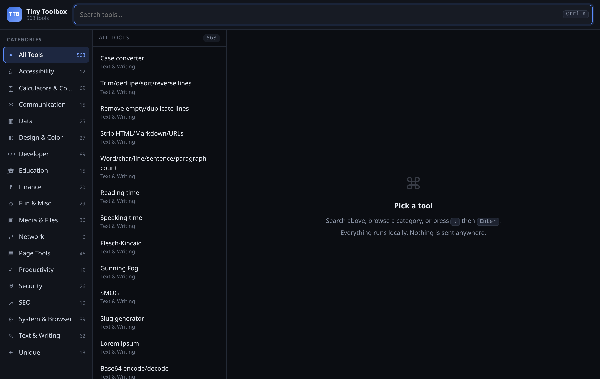
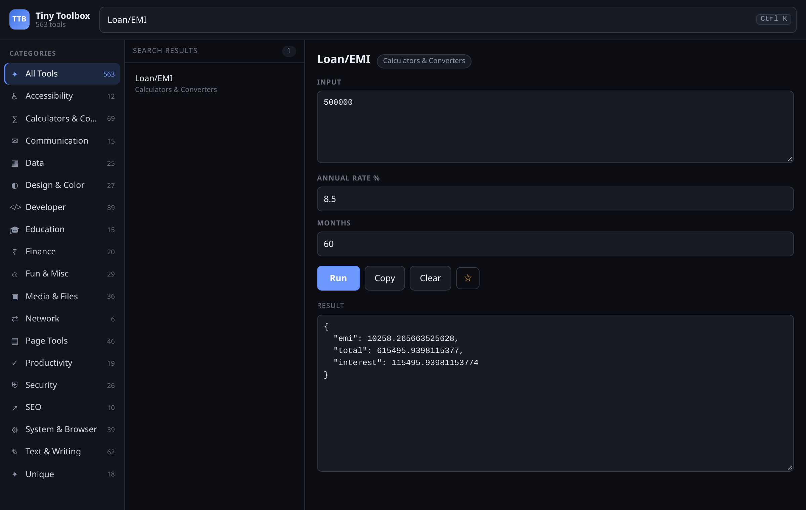
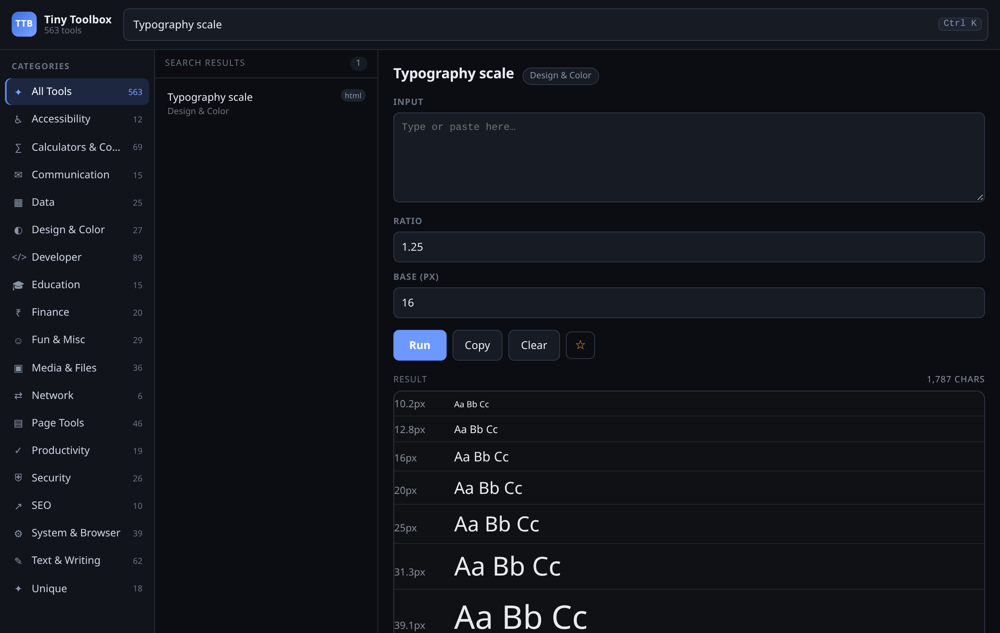
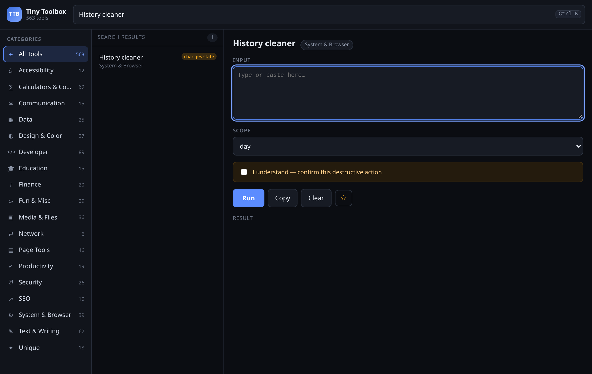

# TTB — Tiny Toolbox

> **564 tools that actually run. One popup. Chrome, Edge, Firefox and Safari. No framework, no telemetry, no remote code.**

TTB (Tiny Toolbox) is a Manifest V3 browser extension that puts a large collection of small, genuinely working utilities — text, calculations, developer helpers, page tools, data, design, finance, media, security, accessibility — behind one fast, offline-first interface.

Every tool in this release was executed with realistic input and its output graded. Tools that could not work were deleted rather than shipped as placeholders. The full evidence is in **[TOOL_AUDIT.md](TOOL_AUDIT.md)**.

## Screenshots

Captured from the real extension UI in headless Chrome.

**Every tool renders the inputs it needs, and reports its result properly**

| Rich output | Destructive tools ask first |
|---|---|
|  |  |

## What the audit found

| Verdict | Count | Meaning |
|---|---:|---|
| Computed output | 271 | does real work, changes with input |
| Works, short output | 64 | real but terse |
| Fixed reference | 97 | same output every time (Big-O, alphabet, unit circle…) |
| Validates input | 28 | correctly rejects bad input with a message |
| Needs a browser API | 31 | `Image`/`document`/`navigator` — fine in the browser |
| Needs a live tab | 64 | page and privileged tools |
| Unavailable here | 5 | speech, BarcodeDetector, EyeDropper — degrade honestly |

**Removed this release: 29 tools** that could never produce a result — 22 needing an unbundled library (all PDF tools, OCR, Excel, Prettier, OpenPGP, axe-core) and 7 no extension can do (notification blocker, popup blocker, canvas-fingerprint blocker, WebRTC leak test, IP viewer, metadata stripper, frames→GIF).

## What's in it

- **564 working tools across 18 categories**, reachable from the popup or side panel.
- **Category rail + search** with keyboard navigation (`↑` `↓` `Enter`), favourites (`★`) and recents.
- **Per-tool inputs** — multi-field tools render exactly the fields they need, including file pickers for media tools.
- **Text, HTML and image output** — rich results render in a sandboxed preview; images render inline with a download link.
- **Destructive actions are gated** — history/cookie/cache cleaners and tab closers are dry-run until you tick the confirmation.

## Runs in your browser

One source tree, assembled per browser with `npm run build`. Every build carries the same catalog; a tool that needs an API the browser lacks is disabled and says so.

| | Chrome / Edge / Brave / Opera | Firefox | Safari |
|---|---|---|---|
| Catalog, popup UI, per-tool inputs | ✅ | ✅ | ✅ |
| Page tools, tab tools, crypto, computation | ✅ | ✅ | ✅ |
| Side panel | ✅ `side_panel` | ✅ `sidebar_action` | — |
| History · bookmarks · downloads · cache clearing · fonts | ✅ | ✅ | — not exposed |
| QR / barcode scanning · screen colour picker | ✅ | — | — |

Full matrix: **[BROWSER_SUPPORT.md](BROWSER_SUPPORT.md)**.

## Install

**Chrome / Edge / Brave / Opera** — open `chrome://extensions`, enable **Developer mode**, **Load unpacked**, pick the folder with `manifest.json`.

**Firefox** — `npm run build:firefox`, then `about:debugging#/runtime/this-firefox` → **Load Temporary Add-on** → `dist/firefox/manifest.json`.

**Safari** — `npm run build:safari`, then convert with `xcrun safari-web-extension-converter`. See `INSTALL.md`.

Prebuilt ZIPs for all four targets are attached to every successful CI run (Actions → *Validate* → Artifacts).

## Development

Vanilla JavaScript, no framework, no build step beyond picking a manifest.

- `npm test` — catalog integrity, dispatcher coverage, registry metadata.
- `npm run audit` — executes every tool and grades the output; writes `tool-audit.json`.
- `npm run build` — assembles `dist/chrome`, `dist/edge`, `dist/firefox`, `dist/safari`.
- `npm run shots` — regenerates the screenshots.

See `TOOL_AUDIT.md`, `BROWSER_SUPPORT.md`, `INSTALL.md`, `USAGE.md`, `CONTRIBUTING.md`, `SECURITY.md`, `WARNINGS.md` and `AUDIT.md`.

<!-- support:sweep -->
## Support

One person's work: no company, no ads, no tracking, no paid tier. If it saved you an
afternoon, a contribution keeps the next one coming — any amount, or none.

| | |
|---|---|
| **UPI** | `drsohilboi@ybl` |
| **Ko-fi** | [ko-fi.com/matneo](https://ko-fi.com/matneo) |
| **PayPal** | [paypal.me/drsohilmomin](https://paypal.me/drsohilmomin?locale.x=en_GB&country.x=IN) |
| **Books** | [the author's other work](https://www.amazon.com/stores/author/B08ZT331LY/allbooks) |
| **Elsewhere** | [all projects](https://drsamonline.github.io/) |
| **Email** | [sohilmomin2000@gmail.com](mailto:sohilmomin2000@gmail.com) — bugs, corrections, requests |

## Privacy and security

Local-first: no analytics, no telemetry, no remote code. Privileged tools use the permissions declared in `manifest.json`. Read `PRIVACY.md` and `SECURITY.md` before deployment.

## License

PolyForm Noncommercial License 1.0.0 — see `LICENSE`.

## Author

**Dr. Sohil Momin**
