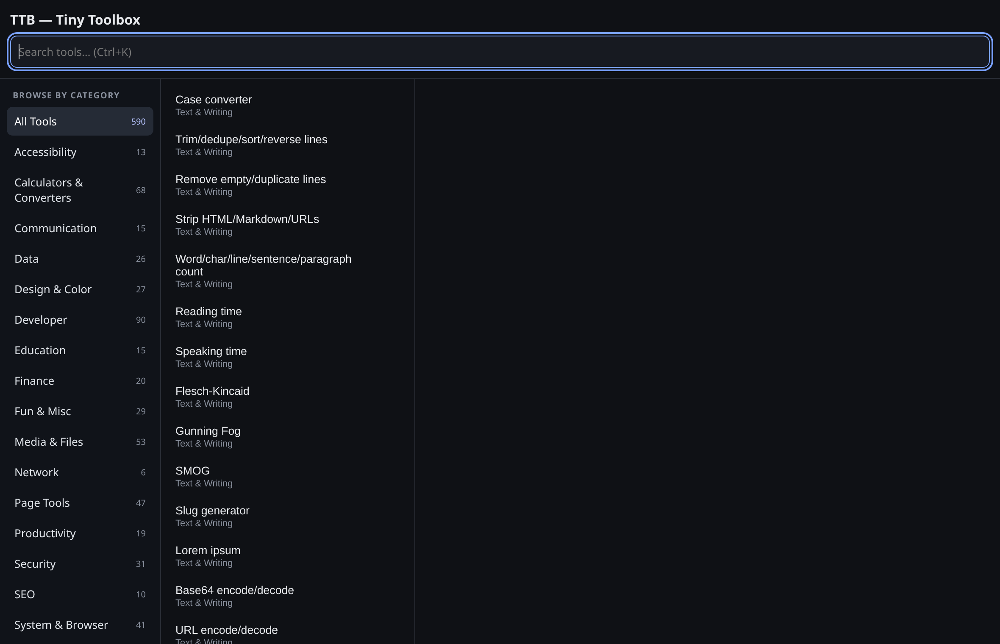
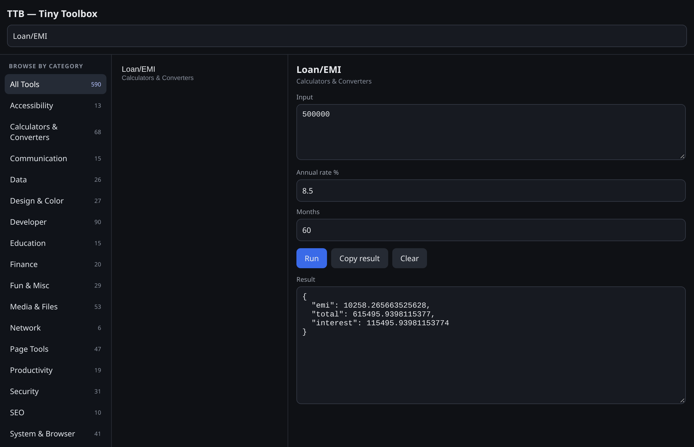
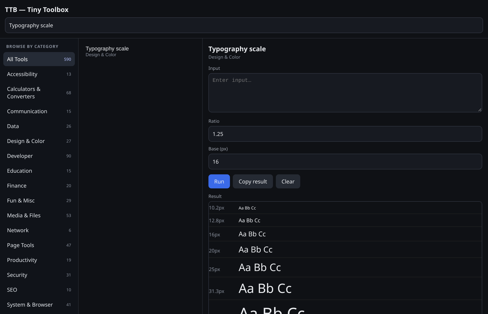
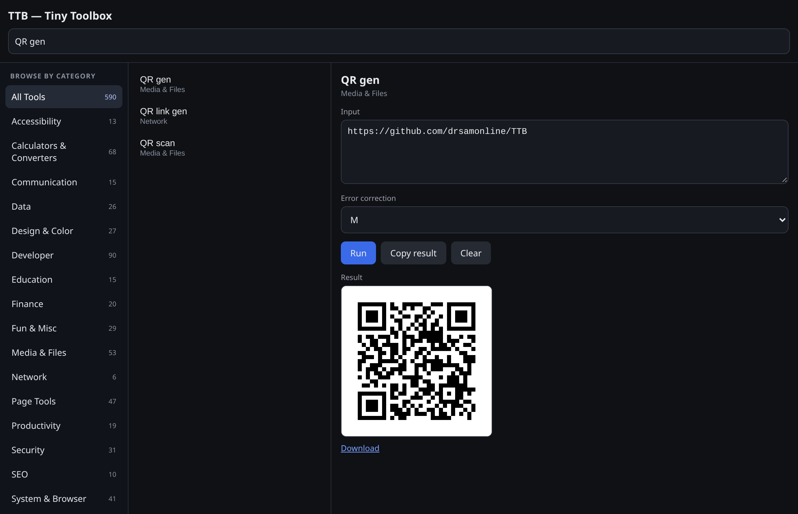
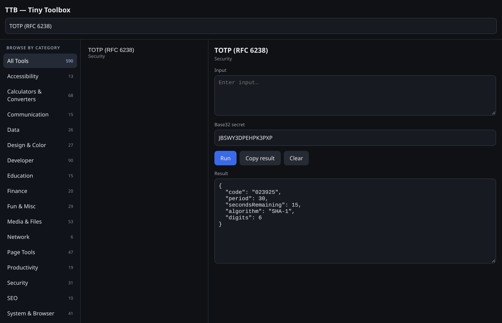
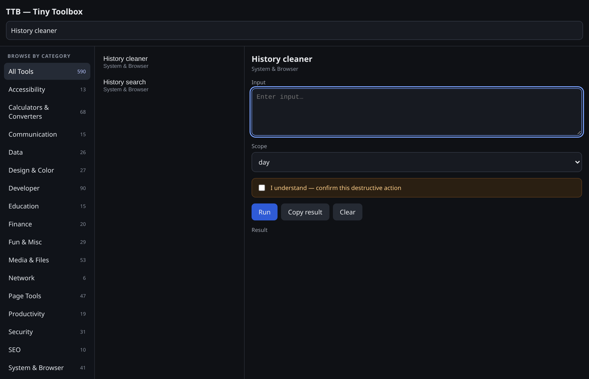

<div align="center">

# TTB — Tiny Toolbox

**591 tools. One extension.** A Manifest V3 browser extension that bundles 591 tiny utilities across 18 categories into one fast, offline-first popup — Chrome, Edge, Firefox and Safari. No framework, no telemetry, no remote code.

[](https://github.com/drsamonline/TTB/stargazers)
[](https://github.com/drsamonline/TTB/network/members)
[](LICENSE)
[](ALL_TOOLS.md)

### ▶ [Open the landing page](https://drsamonline.github.io/TTB/) &nbsp;·&nbsp; [View the repository](https://github.com/drsamonline/TTB) &nbsp;·&nbsp; [All projects](https://drsamonline.github.io/)

<sub>Live site: **https://drsamonline.github.io/TTB/** — install steps, feature tour, screenshots and FAQ.</sub>

</div>

---


[](https://github.com/drsamonline/TTB/actions/workflows/validate.yml)
[](LICENSE)
[](CHANGELOG.md)
[](manifest.json)
[](BROWSER_SUPPORT.md)
[](BROWSER_SUPPORT.md)
[](BROWSER_SUPPORT.md)
[](BROWSER_SUPPORT.md)
[](ALL_TOOLS.md)
[](ALL_TOOLS.md)
[](PRIVACY.md)

> **591 tools. One popup. Chrome, Edge, Firefox and Safari. No framework, no telemetry, no remote code.**

TTB (Tiny Toolbox) is a Manifest V3 browser extension that gathers a large collection of small utilities — text, calculations, developer helpers, page tools, data, design, finance, media, security, accessibility and more — into one fast, offline-first interface, instead of a separate tab or extension for every small task.

## Screenshots

All images below were captured from the real extension UI in headless Chrome.

**Browse the catalog, or filter by category**



**Every tool renders the inputs it needs**



| Rich output | Images render inline |
|---|---|
|  |  |

| Real crypto, offline | Destructive tools ask first |
|---|---|
|  |  |

## Runs in your browser

One source tree, assembled per browser by `npm run build`. Every build carries the full 591-tool catalog; a tool that needs an API a browser does not provide is disabled and **says so plainly** instead of failing silently.

| | Chrome / Edge / Brave / Opera / Vivaldi | Firefox | Safari |
|---|---|---|---|
| Catalog, popup UI, per-tool inputs | ✅ | ✅ | ✅ |
| Page tools, tab tools, crypto, all pure-computation tools | ✅ | ✅ | ✅ |
| Side panel | ✅ `side_panel` | ✅ `sidebar_action` | — |
| History · bookmarks · downloads · extension manager · cache clearing · font list | ✅ | ✅ | — not exposed by Safari |
| QR / barcode scanning · screen colour picker | ✅ | — | — |
| Packaging | Load unpacked | Load temporary add-on, or sign on AMO | Convert with Xcode |

Full matrix, including what each browser changes and the exact gaps: **[BROWSER_SUPPORT.md](BROWSER_SUPPORT.md)**.

## What's in it

- **591 cataloged tools across 18 categories**, all reachable from the popup or the side panel.
- **A real category browser** — pick a category, see its count, then search within it. You don't need to know a tool's name to find it.
- **Per-tool inputs.** Multi-field tools (EMI, tax, tip, regex, colour, matrix, image jobs…) render the fields they actually need — encode/decode switches, extra values, and file pickers for media tools.
- **Text, HTML and image output.** Rich results (markdown previews, colour palettes, CSS generators, charts, even small games) render in a sandboxed preview; images render inline with a download link.
- **Destructive actions are gated.** History/cookie/cache cleaners, duplicate-tab closing and auto-close are dry-run by default and only act after you tick an explicit confirmation.

## How it is built

```
popup.html / sidebar.html
  ├─ data/tools.js        → globalThis.TTB_CATALOG  (591 entries)
  └─ ui/app.js            → renders the catalog, builds inputs, runs tools
       └─ (on first Run) tools/core.js  → dispatcher
            ├─ text · calc · dev · page · system · security   (core handlers)
            ├─ phase4–7 + t-*.js                              (bundled modules)
            ├─ tools/compat.js                                (namespace + capability layer)
            └─ ui/registry.js                                 (name → handler, inputs)
background.js             → context menu + keyboard commands only
build.mjs + browsers/*.json → per-browser packages (dist/chrome, edge, firefox, safari)
lazy/loader.js            → optional third-party loader (nothing is downloaded)
```

The catalog is separated from execution, so the tool list renders even if a handler or a privileged API fails. Tool execution is imported on demand. There is **no network layer** in the extension: nothing is fetched, phoned home, or loaded remotely.

`tools/compat.js` is the only place that knows about browser differences: it points `chrome` at Firefox's promise-based `browser` namespace and records which APIs actually exist, so handlers can report an honest message on Safari instead of throwing.

## Honest limitations

- **Optional third-party libraries are not bundled.** 24 tools (PDF merge/split/rotate, PDF→text, OCR, Excel viewer, Prettier, OpenPGP, QR scanning helpers, axe-core, zxcvbn…) report their required local dependency instead of pretending to run. No remote code is fetched.
- **Safari is the most limited target.** It exposes no history, bookmarks, downloads, management, browsingData or fontSettings APIs, so those tools are disabled there. Safari also needs an Xcode conversion step and a signed build.
- **Firefox has no side panel** (it uses `sidebar_action`) and no `BarcodeDetector` or `EyeDropper`.
- **Some tools are intentionally lightweight.** A few provide guidance, generators or browser-native behaviour rather than the depth of a specialist app.
- **Browser tools need the right context.** Tab, history, cookie, bookmark, download and page tools can fail on restricted pages (e.g. `chrome://`, the Web Store, other extensions' pages).
- **Recording tools are interactive.** Screen/audio/webcam capture need a permission prompt and keep the popup open for the duration.

These limitations are documented deliberately rather than hidden.

## Install

**Chrome, Edge, Brave, Opera, Vivaldi** — download or clone the repository, open `chrome://extensions` (or `edge://extensions`), enable **Developer mode**, choose **Load unpacked**, and select the folder containing `manifest.json`.

**Firefox** — build the Firefox package (`npm run build:firefox`), then open `about:debugging#/runtime/this-firefox` and **Load Temporary Add-on…** → pick `dist/firefox/manifest.json`.

**Safari** — build the Safari package (`npm run build:safari`) and convert it with `xcrun safari-web-extension-converter`, then run the Xcode project.

Prebuilt ZIPs for every browser are attached to each successful CI run (Actions → *Validate* → Artifacts). See `INSTALL.md` for details.

## Development

No build step beyond picking a manifest, and no framework. Vanilla JavaScript and browser APIs.

- `npm test` — smoke test: catalog integrity, dispatcher coverage, registry metadata.
- `npm run build` — assembles `dist/chrome`, `dist/edge`, `dist/firefox`, `dist/safari`.
- `npm run shots` — regenerates the screenshots above from the real UI in headless Chrome.
- CI syntax-checks every module, runs the smoke test, builds all four targets, smoke-tests each package, and uploads the ZIPs.

See `INSTALL.md`, `USAGE.md`, `BROWSER_SUPPORT.md`, `CONTRIBUTING.md`, `SECURITY.md`, `WARNINGS.md` and `AUDIT.md`.

## Privacy and security

Local-first: no analytics, no telemetry, no remote code. Privileged tools use the permissions declared in `manifest.json`, and each browser build requests only what that browser can grant. Read `PRIVACY.md` and `SECURITY.md` before deployment, and `WARNINGS.md` for the caveats that matter.

## License

PolyForm Noncommercial — see `LICENSE`.

## Author

**Dr. Sohil Momin**
